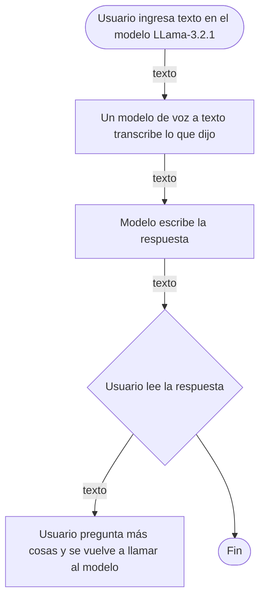
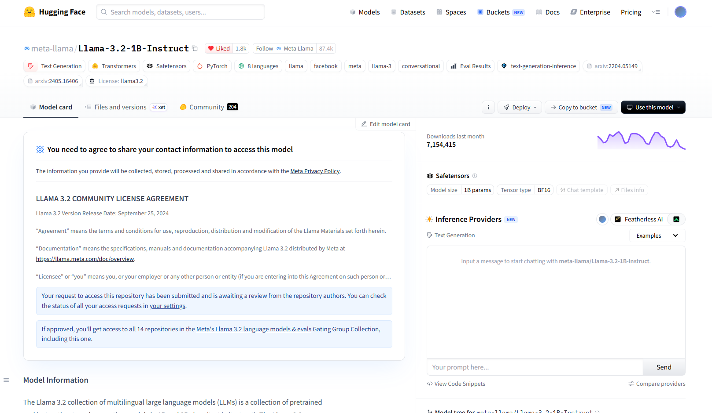

# Tutor para estudiantes

> Un tutor conversacional de repaso para estudiantes universitarios sin acceso inmediato a un profesor o compañero.

**Proyecto integrador · Herramientas de IA**
**Equipo:** 2

## 👥 Integrantes

| Nombre completo            |
| -------------------------- |
| Uriel Gutiérrez Mosqueira  |
| Sebastián Guerrero Ambriz  |
| Angela de la Rosa Sevilla  |
| Alejandro Zapien Castrejón |

## 1. Caso de uso

Se propone un tutor conversacional de repaso para estudiantes universitarios sin acceso inmediato a un profesor o compañero. El estudiante escribe, en lenguaje natural, el tema o duda que quiere repasar, y el sistema responde con una explicación breve en español, a nivel universitario, pudiendo seguir la conversación si se pide más detalle o un ejemplo distinto. El objetivo no es sustituir al profesor, sino ofrecer una primera explicación disponible en cualquier momento, especialmente en semanas de alta carga académica.

- **Entrada:** texto
- **Salida**: texto
## 🔀 Cómo funciona

## 2. Modelo abierto elegido

| Dato                         | Respuesta                                                                                                                                                                                                                   |
| ---------------------------- | --------------------------------------------------------------------------------------------------------------------------------------------------------------------------------------------------------------------------- |
| Identificador                | [meta-llama/Llama-3.2-1B-Instruct](https://huggingface.co/meta-llama/Llama-3.2-1B)                                                                                                                                          |
| Tarea (pipeline tag)         | `text-generation`                                                                                                                                                                                                           |
| Número de parámetros         | 1.23B                                                                                                                                                                                                                       |
| Licencia                     | Llama 3.2 Community License                                                                                                                                                                                                 |
| Limitación o sesgo declarado | Las pruebas se realizaron principalmente en inglés y no cubrieron todos los escenarios posibles, por lo que el modelo puede producir en ocasiones respuestas inexactas, sesgadas o inapropiadas ante ciertas instrucciones. |

## 3. Viabilidad de hardware

$$
\text{Memoria mínima} = 1.23B \times 2\ \text{bytes} \approx \ 2.46\ \text{GB}
$$

- **VRAM disponible en Colab:** 14.56 GB (Tesla T4)
- **Dónde se ejecuta:** Colab con GPU
- **Por qué:** Dado que es pequeño 
y cabe cómodamente en la T4, se ejecutará de forma local en Colab con GPU (en lugar de vía API), lo cual evita 
costos por petición y facilita iterar sobre el prompt del tutor sin depender de un proveedor externo. 

## 4. Riesgo ético

- **Riesgo:** La responsabilidad ante un error
- **Mitigación:** El sistema mostrará siempre un aviso visible de que las respuestas pueden contener errores y deben 
verificarse con el material del curso, y se limitará el caso de uso a temas de repaso general (no a la resolución de 
exámenes o tareas calificadas).

## 5. Evidencia

